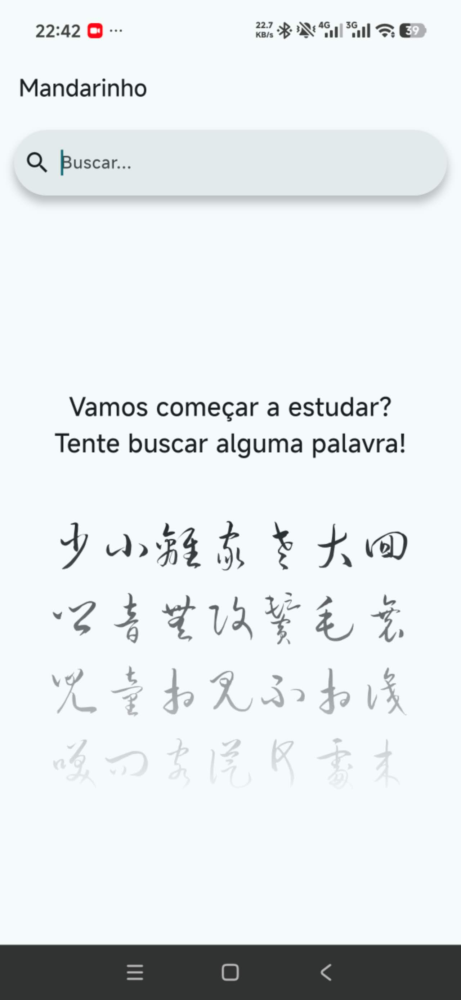
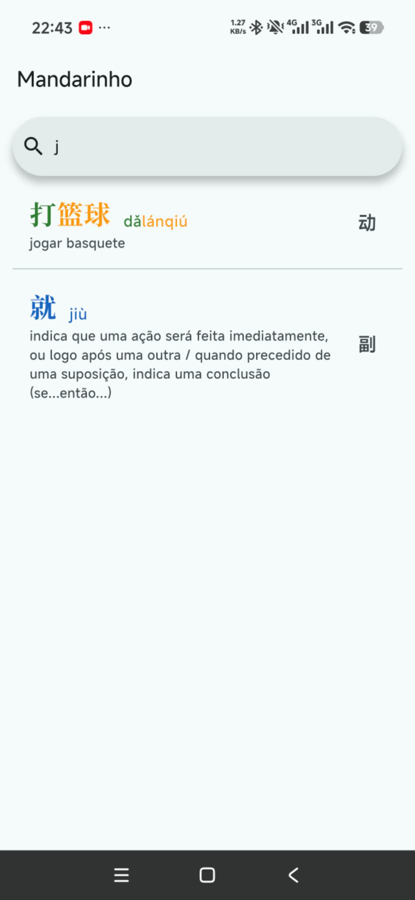
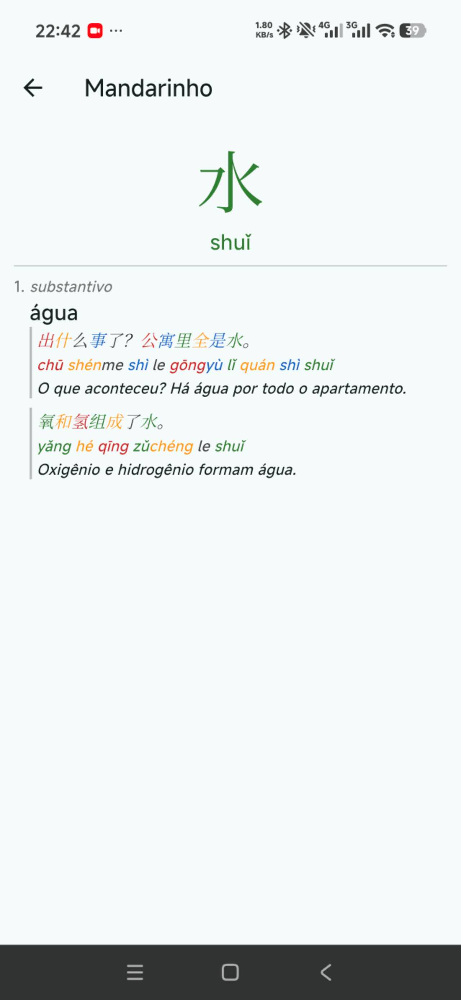
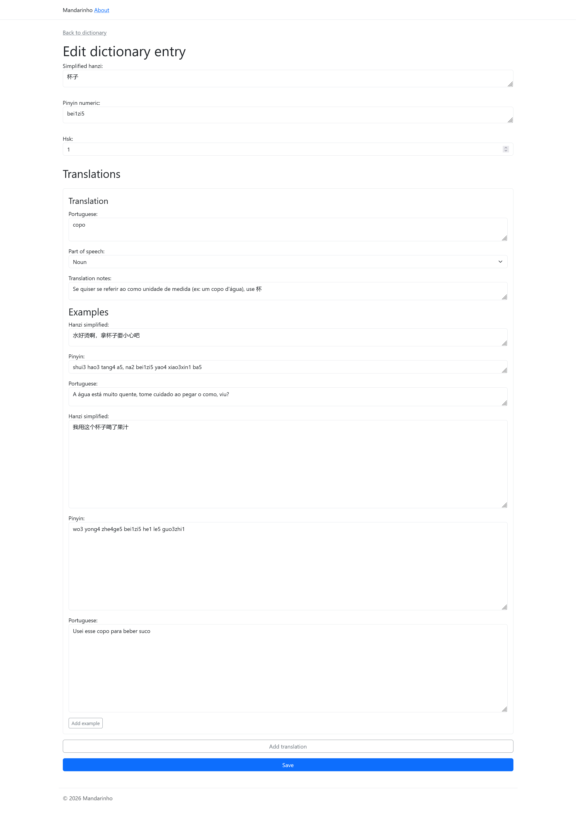

# mandarinho

A CN-PT_BR mobile dictionary. Has also a web interface for database management (creation, editing, ...)

## Mobile App Screenshots

| main                          | search                          | entry                          |
| ----------------------------- | ------------------------------- | ------------------------------ |
|  |  |  |

## Webui Screenshots

On the webui, we automatically generate pinyin for the entries. They can be edited, of course, as sometimes it'll guess the wrong variation of a word.

